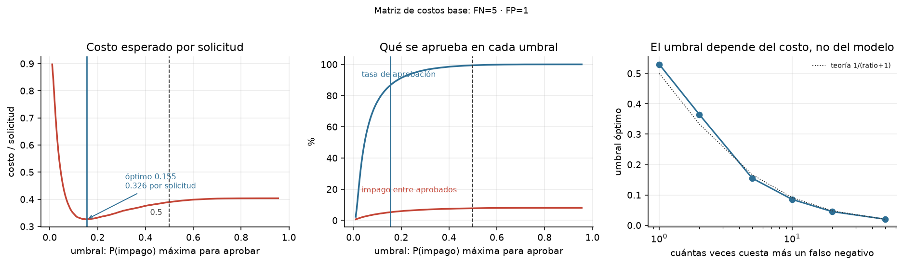
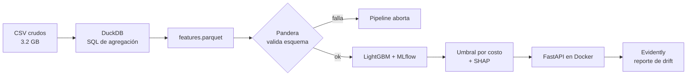
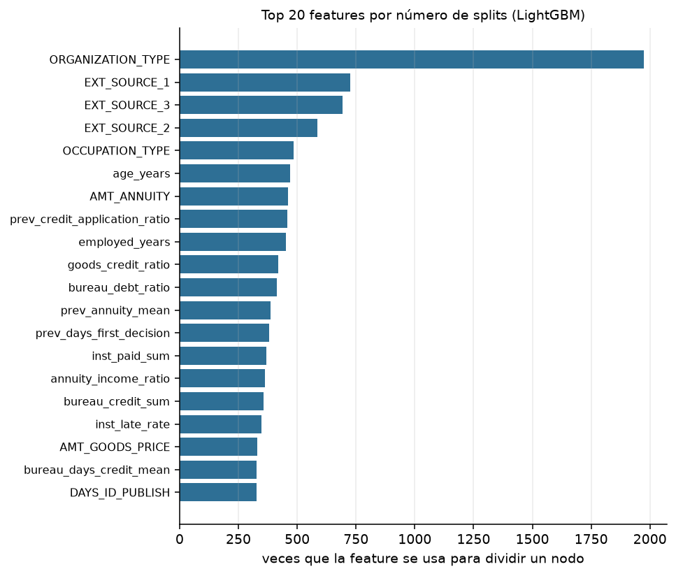
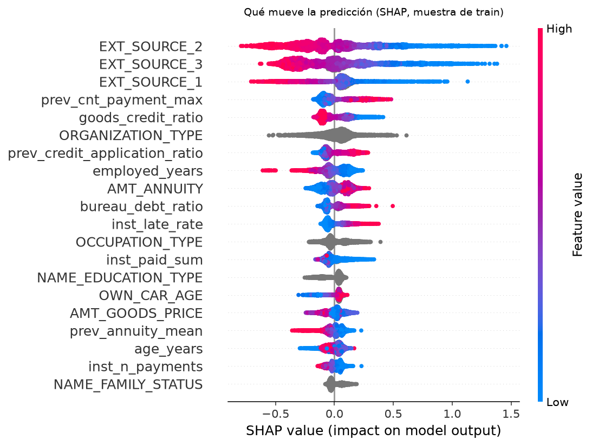
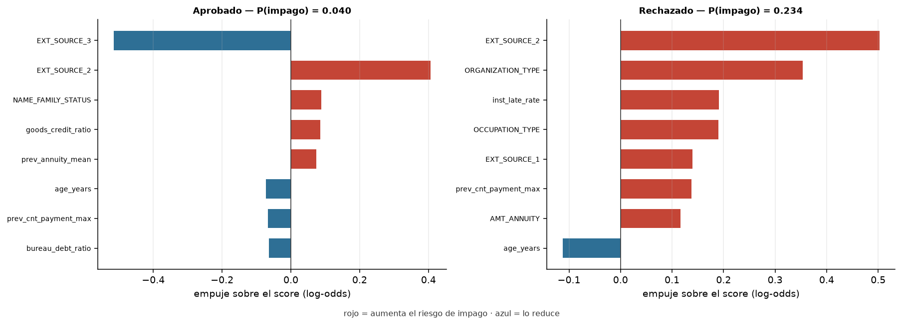
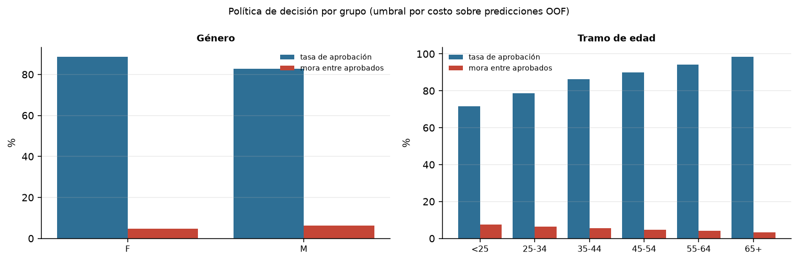
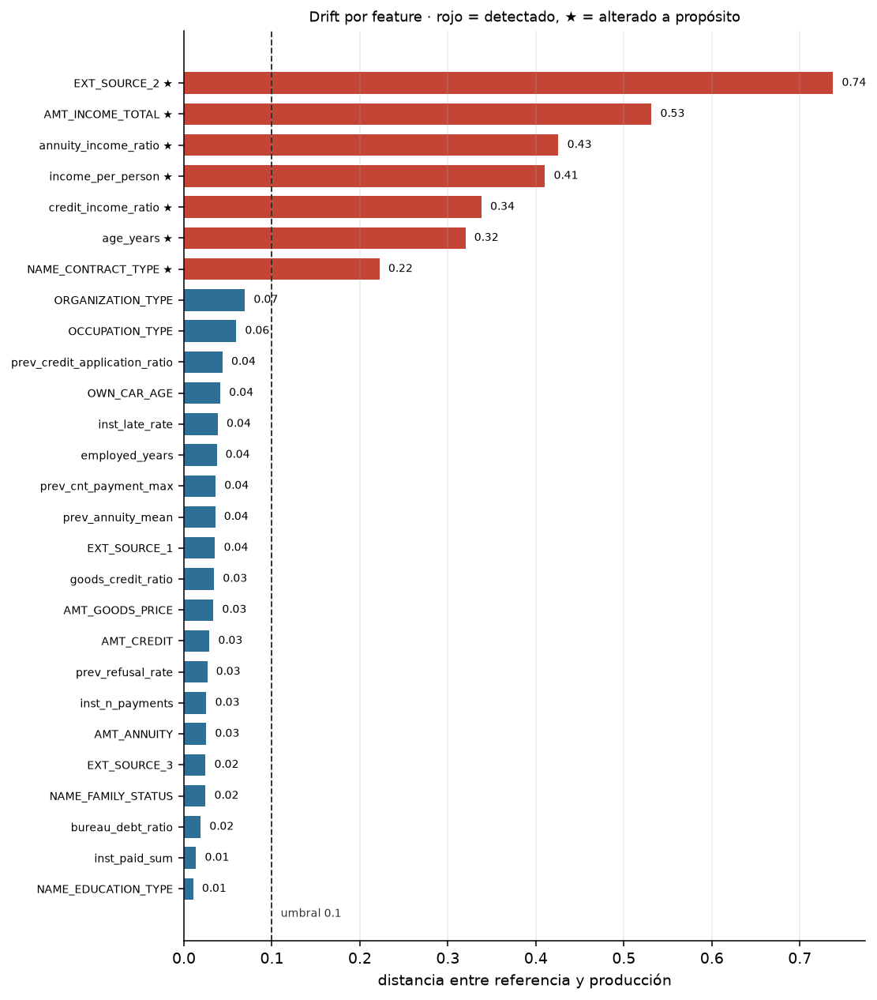

# Ayni 🤝


<!-- CI verde (run 42033698168). El badge solo renderiza con el repo público;
     al publicarlo, descomentar la línea siguiente. -->
<!--  -->

**Scoring de riesgo crediticio de punta a punta: modelo explicable, decisión por costo y monitoreo de drift.**

> *Ayni* es el principio andino de reciprocidad: dar y devolver. El crédito funciona igual, sobre la confianza de que lo recibido será devuelto.

---

## Resultados clave

**Evaluación final en el test congelado (61 503 solicitudes).** El test se leyó dos veces: la
segunda, tras fijar `deterministic=True` en LightGBM para que los números fueran reproducibles
(ROC-AUC 0.7829 → 0.7815). Ninguna decisión se tomó mirando el test.

- **ROC-AUC 0.782** y **PR-AUC 0.277** en test (validación cruzada: 0.780 / 0.269). Sin sorpresa
  desagradable: el modelo generaliza.
- **El umbral óptimo no es 0.5, es 0.155.** Aprobar con 0.5 equivale a aprobar al 99.3 % de los
  solicitantes; el corte calculado aprueba al **86.6 %**.
- **El costo total baja un 17.3 %** (23 862 → 19 744) y la mora entre aprobados cae del
  **7.8 % al 5.2 %**.
- **Excluir `CODE_GENDER` cuesta +0.0014 AUC** (0.7802 con género vs 0.7789 sin él, mismos
  hiperparámetros). Menos de dos milésimas: la decisión queda con su precio publicado y no hay
  argumento de rendimiento para revertirla.
- **`scale_pos_weight` empeora el modelo** (0.7776 vs 0.7789): el desbalance se trata en el umbral
  de decisión, no en el entrenamiento.



| Métrica | Validación cruzada | Test |
|---|---|---|
| ROC-AUC · LightGBM | **0.7798** ± 0.0026 | **0.7815** |
| PR-AUC · LightGBM | **0.2692** | **0.2768** |
| ROC-AUC · baseline logístico | 0.7658 ± 0.0019 | — |
| PR-AUC · baseline logístico | 0.2439 | — |
| Costo total al umbral 0.5 | 95 871 (0.390/solicitud) | 23 862 (0.388/solicitud) |
| Costo total al umbral 0.155 | **80 220 (0.326/solicitud)** | **19 744 (0.321/solicitud)** |

---

## Problema y motivación

Un banco no gana por predecir bien: gana por decidir bien. **Aprobar a un mal pagador cuesta varias veces más que rechazar a un buen cliente**, así que el umbral de 0.5 —el que trae cualquier modelo por defecto— no es una decisión económica, es una decisión arbitraria.

Además, en crédito la predicción tiene que ser explicable: si el banco rechaza a alguien, debe poder decirle por qué. Un modelo opaco no es desplegable, por bueno que sea. Y un modelo que envejece sin monitoreo es un pasivo silencioso.

Ayni cubre las tres cosas: la predicción, la decisión por costo y la explicación, dentro de un pipeline que se puede reproducir y monitorear.

---

## Uso rápido

> Requiere el entorno instalado y el modelo exportado; los pasos completos están en
> [Cómo reproducirlo](#cómo-reproducirlo).

```bash
ayni export-model        # deja el modelo y el umbral en models/
docker compose up        # API en :8000/docs · MLflow en :5000
```

```bash
curl -X POST localhost:8000/predict \
  -H "Content-Type: application/json" \
  -d '{"amt_income_total": 180000, "amt_credit": 450000, "amt_annuity": 24500,
       "age_years": 34, "years_employed": 4, "ext_source_1": 0.55,
       "ext_source_2": 0.61, "ext_source_3": 0.40, "contract_type": "Cash loans"}'
```

```json
{"probabilidad": 0.0614, "decision": "approve", "umbral": 0.155, "modelo_version": "1"}
```

Y la explicación de un cliente de alto riesgo, con las razones que se le darían al rechazarlo:

```bash
curl -X POST localhost:8000/explain \
  -H "Content-Type: application/json" \
  -d '{"amt_income_total": 96000, "amt_credit": 900000, "amt_annuity": 45000,
       "age_years": 23, "children": 3, "family_members": 5,
       "ext_source_1": 0.12, "ext_source_2": 0.18, "ext_source_3": 0.09,
       "education": "Lower secondary", "occupation": "Low-skill Laborers",
       "organization": "Self-employed", "bureau_debt_ratio": 0.95,
       "prev_refusal_rate": 0.9, "inst_late_rate": 0.45}'
```

```json
{"probabilidad": 0.5972, "decision": "reject", "umbral": 0.155, "modelo_version": "1",
 "razones": [
   {"feature": "EXT_SOURCE_3",       "valor": 0.09,  "contribucion": 0.9877, "direccion": "aumenta_riesgo"},
   {"feature": "EXT_SOURCE_2",       "valor": 0.18,  "contribucion": 0.5596, "direccion": "aumenta_riesgo"},
   {"feature": "EXT_SOURCE_1",       "valor": 0.12,  "contribucion": 0.5348, "direccion": "aumenta_riesgo"},
   {"feature": "prev_refusal_rate",  "valor": 0.9,   "contribucion": 0.2147, "direccion": "aumenta_riesgo"},
   {"feature": "bureau_debt_ratio",  "valor": 0.95,  "contribucion": 0.2117, "direccion": "aumenta_riesgo"}
 ],
 "cobertura": 0.108, "advertencia": null}
```

`cobertura` es la fracción de los 185 campos del modelo que llegó en la petición, y `advertencia` se
activa si es muy baja: el servicio no inventa razones sobre datos que no recibió. El contrato HTTP
cubre como máximo el **15.7 %** de esos 185 campos (el resto son columnas del expediente que el
modelo usa y la API no pide); los que faltan viajan como nulos, igual que en el entrenamiento.

---

## Datos

**Home Credit Default Risk** — [Kaggle](https://www.kaggle.com/competitions/home-credit-default-risk).

| Tabla | Contenido | Grano | Filas |
|---|---|---|---:|
| `application_train.csv` | Solicitud actual: ingresos, monto, edad, empleo | 1 fila por solicitud | 307 511 |
| `bureau.csv` | Créditos en otras entidades | 1 fila por crédito previo | 1 716 428 |
| `previous_application.csv` | Solicitudes previas en Home Credit | 1 fila por solicitud previa | 1 670 214 |
| `installments_payments.csv` | Cuotas pagadas | 1 fila por cuota | 13 605 401 |
| `credit_card_balance.csv` | Saldos mensuales de tarjeta | 1 fila por mes | 3 840 312 |

- **Target:** `TARGET` (1 = impago). **Desbalance medido:** **8.07 %** de impagos
  (24 825 de 307 511), ratio 11.4:1 frente a los que pagan.
- **`EXT_SOURCE_1/2/3`** son las variables continuas más predictivas (correlación −0.155 / −0.160 /
  −0.179 con el impago), pero `EXT_SOURCE_1` viene nula en el 56 % de las filas.
- **Particularidades verificadas en el EDA:** 41 de 122 columnas tienen >50 % de nulos;
  `DAYS_EMPLOYED = 365243` es un centinela ("jubilado/desempleado", 18.0 % de las filas) y no un
  valor real; `DAYS_BIRTH` viene en días negativos.
- El análisis completo está en [`notebooks/01_eda.ipynb`](notebooks/01_eda.ipynb), con seis figuras
  en [`reports/figures/`](reports/figures/).
- `application_test.csv` no trae `TARGET`, así que el test set de evaluación se reserva a partir de `application_train`.

> Los datos no se versionan (`data/` está en `.gitignore`): **3.2 GB** de CSV, que quedan en 530 MB
> tras convertirlos a Parquet. Conteos medidos con `ayni check`.

---

## Enfoque y arquitectura



1. **Features en SQL, no en pandas.** Cada tabla se agrega a una fila por `SK_ID_CURR` con un `.sql` propio; DuckDB lee los Parquet sin cargarlos enteros en memoria. Resultado: **188 columnas, 60 de ellas agregadas** de 4 tablas relacionales, en 17 s.
2. **Validación antes de modelar.** Tres esquemas Pandera (tabla cruda, features, particiones) cortan el pipeline si aparecen tipos, rangos o nulos imposibles; `ayni validate` comprueba lo ya escrito y devuelve código de salida 1. Un CSV corrupto de prueba en `tests/fixtures/` demuestra que el corte funciona.
3. **Split estratificado 80/20 con semilla fija.** El 20 % de test no se toca hasta la evaluación final; todo lo demás se decide en validación cruzada.
4. **Dos métricas, no una.** ROC-AUC para comparar con el estándar de la competencia y PR-AUC porque con 8 % de positivos es la lectura honesta.
5. **Se comparó el peso de clases contra no usarlo.** `scale_pos_weight` bajó el ROC-AUC (0.7776 vs 0.7789): el desbalance se resuelve en el umbral de decisión, no recoloreando el entrenamiento.
6. **Umbral por costo.** Se recorre la curva de umbrales y se elige el que minimiza el costo esperado, con la matriz documentada.
7. **Explicación dentro del servicio.** SHAP global para el reporte, SHAP local convertido en *reason codes* para cada decisión individual.
8. **Trazabilidad completa.** Cada corrida queda en MLflow y el mejor modelo va al Model Registry con su umbral pegado al artefacto.
9. **Compuerta de calidad.** `ayni evaluate` falla si el ROC-AUC del test baja de **0.75**, y CI corre los 66 tests en cada push sin necesitar el dataset: todo se construye con datos sintéticos y modelos diminutos.

---

## Resultados

### Modelos

Validación cruzada de 5 folds sobre `train.parquet` (246 008 filas). Cinco corridas comparables
registradas en MLflow; el campeón es `lgbm-ajustado` (v1 del Registry).

| Corrida | ROC-AUC (CV) | PR-AUC (CV) | Notas |
|---|---|---|---|
| `lgbm-ajustado` | **0.7798** ± 0.0026 | **0.2692** | campeón registrado |
| `lgbm-base` | 0.7789 ± 0.0026 | 0.2676 | hiperparámetros por defecto |
| `lgbm-pos-weight` | 0.7776 ± 0.0025 | 0.2665 | `scale_pos_weight` = 11.4 |
| `baseline-logreg` | 0.7658 ± 0.0019 | 0.2439 | imputación + escalado + one-hot |
| `lgbm-con-genero` | 0.7802 ± 0.0026 | 0.2690 | **solo para medir**, excluida del registro |

| ROC-AUC (test) | PR-AUC (test) |
|---|---|
| **0.7815** | **0.2768** |

### Decisión por costo

Matriz documentada: aprobar a quien no paga cuesta **5** (pérdida de principal) y rechazar a quien
sí pagaría cuesta **1** (margen no ganado). El umbral óptimo se eligió sobre las predicciones
**out-of-fold**, nunca sobre el test.

| Umbral | Tasa de aprobación | Impago entre aprobados | Costo total | Costo por solicitud |
|---|---:|---:|---:|---:|
| 0.50 (por defecto) | 99.3 % | 7.8 % | 23 862 | 0.388 |
| **0.155 (óptimo)** | **86.6 %** | **5.2 %** | **19 744** | **0.321** |

Resultados sobre el test congelado (61 503 solicitudes, fingerprint verificado antes de leerlo).

**El umbral sigue a los costos, no al modelo.** Con un modelo calibrado, el corte que iguala costo
marginal de aprobar y de rechazar vale `1/(ratio+1)`; el barrido empírico lo reproduce casi exacto,
lo que confirma que las probabilidades están bien calibradas:

| Ratio FN:FP | Umbral óptimo medido | Teoría `1/(ratio+1)` | Tasa de aprobación |
|---|---:|---:|---:|
| 1:1 | 0.530 | 0.500 | 99.6 % |
| 2:1 | 0.365 | 0.333 | 97.9 % |
| 5:1 | 0.155 | 0.167 | 86.6 % |
| 10:1 | 0.085 | 0.091 | 71.2 % |
| 20:1 | 0.045 | 0.048 | 48.1 % |
| 50:1 | 0.020 | 0.020 | 16.7 % |



`ORGANIZATION_TYPE` domina por delante de las tres `EXT_SOURCE_*`: es una categórica de 58 niveles
y contar cuántas veces se usa una feature para dividir un nodo (la importancia por defecto de
LightGBM) favorece ese tipo de variable, así que el orden exacto hay que leerlo con pinzas. La
lectura sólida es que **las `EXT_SOURCE_*` son el bloque continuo más fuerte**, y que los ratios construidos en el feature engineering (`prev_credit_application_ratio`,
`bureau_debt_ratio`, `annuity_income_ratio`) entran directo al top 20.

### Explicabilidad

SHAP sobre una muestra de 5 000 solicitudes de train. **El ranking no coincide con la importancia
nativa de LightGBM, y esa discrepancia es el punto:** `ORGANIZATION_TYPE` es la feature #1 por
número de splits (categórica de 58 niveles, que infla esa métrica), la #3 por ganancia y cae al
**#6** cuando se mide el impacto real sobre la predicción.

| # | Feature | \|SHAP\| medio |
|---|---|---:|
| 1 | `EXT_SOURCE_2` | 0.3049 |
| 2 | `EXT_SOURCE_3` | 0.2771 |
| 3 | `EXT_SOURCE_1` | 0.1576 |
| 4 | `prev_cnt_payment_max` | 0.1151 |
| 5 | `goods_credit_ratio` | 0.1039 |
| 6 | `ORGANIZATION_TYPE` | 0.0919 |



**Lectura:** las tres `EXT_SOURCE_*` son el bloque dominante, y su efecto es monótono: score alto
(rojo) empuja el riesgo hacia abajo. Los ratios construidos en el feature engineering aparecen en el top 10, así
que el feature engineering no fue decorativo.



**Dos casos reales, elegidos por su probabilidad mediana dentro de cada grupo** (no los extremos):

- **Aprobado (P = 0.040):** lo sostiene sobre todo un `EXT_SOURCE_3` alto (0.87, −0.515), con
  apoyo de la edad (51 años), cero deuda viva en el buró y créditos previos a 12 cuotas como
  máximo. La figura muestra también lo que juega en contra (`EXT_SOURCE_2`, +0.41); las razones
  que se le comunican, en cambio, son solo las que bajan el riesgo.
- **Rechazado (P = 0.234):** `EXT_SOURCE_2 = 0.25` aporta +0.502, trabajar en construcción
  (`ORGANIZATION_TYPE`) suma +0.353 y haber pagado tarde el 35 % de sus cuotas previas
  (`inst_late_rate`) añade +0.191. Tres motivos que un analista de crédito puede defender.

### Reason codes

`ayni explain` genera el formato que consumirá `/explain`: las cinco features de mayor \|SHAP\|, con
su valor, su contribución en log-odds y la dirección del riesgo. **Las razones se filtran por
decisión:** un rechazo solo lleva motivos que suben el riesgo, y una aprobación solo los que lo
bajan. Darle a un rechazado un argumento a su favor es confuso y, en banca, insostenible.

```json
{"sk_id_curr": 396395, "probabilidad": 0.2344, "umbral": 0.155, "decision": "reject",
 "razones": [
   {"feature": "EXT_SOURCE_2",         "valor": 0.2479,         "contribucion": 0.5023, "direccion": "aumenta_riesgo"},
   {"feature": "ORGANIZATION_TYPE",    "valor": "Construction", "contribucion": 0.3533, "direccion": "aumenta_riesgo"},
   {"feature": "inst_late_rate",       "valor": 0.35,           "contribucion": 0.1913, "direccion": "aumenta_riesgo"},
   {"feature": "OCCUPATION_TYPE",      "valor": "Laborers",     "contribucion": 0.1898, "direccion": "aumenta_riesgo"},
   {"feature": "prev_cnt_payment_max", "valor": 42.0,           "contribucion": 0.1379, "direccion": "aumenta_riesgo"}
 ]}
```

Los valores están en **log-odds**, la escala en la que el modelo razona; convertirlos a puntos de
score o a probabilidad es una decisión de presentación, no de cálculo.

### Sesgo de la política, medido

Excluir `CODE_GENDER` del modelo no garantiza un resultado justo: el sesgo puede entrar por variables
correlacionadas. Se auditan las **predicciones OOF** (las mismas con las que se eligió el umbral) y se
mira cada grupo por separado con tres preguntas distintas:

- **¿A quién se aprueba?** Tasa de aprobación total y entre quienes sí pagaron.
- **¿Qué riesgo se asume?** Mora entre los aprobados.
- **¿El modelo le asigna a cada grupo el riesgo que tiene?** Mora predicha (media de la
  probabilidad) contra mora observada: es la **calibración por grupo**, la única de las tres que
  dice si una brecha la explica el riesgo.

| Género | n | Aprobación | Aprob. entre los que pagan | Mora observada | Mora predicha | Mora entre aprobados | Regla del 80 % |
|---|---:|---:|---:|---:|---:|---:|---:|
| F | 161 887 | **88.7 %** | 90.9 % | 7.0 % | **7.3 %** | 4.7 % | 1.00 |
| M | 84 119 | 82.6 % | 86.1 % | 10.1 % | **9.3 %** | 6.4 % | 0.93 |

| Tramo de edad | n | Aprobación | Aprob. entre los que pagan | Mora observada | Mora predicha | Mora entre aprobados | Regla del 80 % |
|---|---:|---:|---:|---:|---:|---:|---:|
| <25 | 9 841 | 71.5 % | 75.6 % | 12.4 % | 12.6 % | 7.5 % | **0.73** |
| 25-34 | 58 061 | 78.8 % | 82.6 % | 10.7 % | 10.5 % | 6.4 % | **0.799** |
| 35-44 | 67 372 | 86.4 % | 89.2 % | 8.4 % | 8.1 % | 5.5 % | 0.88 |
| 45-54 | 56 151 | 89.8 % | 91.9 % | 7.0 % | 7.0 % | 4.8 % | 0.91 |
| 55-64 | 48 357 | 94.3 % | 95.5 % | 5.4 % | 5.4 % | 4.2 % | 0.96 |
| 65+ | 6 226 | 98.6 % | 98.9 % | 3.7 % | 3.6 % | 3.4 % | 1.00 |



**Lectura de los dos resultados, que no son el mismo caso:**

- **Edad: no cumple la regla del 80 %** en menores de 25 (0.73) y queda justo por debajo en 25-34
  (0.799). Pero la calibración es buena en todos los tramos (predicha y observada difieren en
  menos de medio punto): el modelo le asigna a cada edad el riesgo que realmente tiene, así que la
  brecha es de **riesgo medido**, no un error del modelo. Que los buenos pagadores jóvenes se
  aprueben menos (75.6 % vs 98.9 %) es la consecuencia esperable: con tasas de impago distintas, un
  modelo calibrado **no puede** igualar además la aprobación de los buenos pagadores; las dos
  propiedades son incompatibles salvo con un modelo perfecto. Elegir cuál priorizar es una
  decisión de política y, en varios marcos legales, la edad es categoría protegida con matices.
  Queda declarado, no resuelto.
- **Género: cumple la regla del 80 %** (0.93), pero la calibración muestra lo que la tasa de
  aprobación esconde. Sin `CODE_GENDER`, el modelo **sobrestima el riesgo de las mujeres** (7.3 %
  predicho vs 7.0 % real) y **subestima el de los hombres** (9.3 % vs 10.1 %): al no ver la
  variable, promedia a ambos grupos, y ese promedio lo pagan ellas. Excluir una variable no la
  vuelve neutral. Corregirlo exigiría usar el género (por ejemplo, para calibrar por grupo), lo
  que tiene su propio problema legal; también queda declarado.

Se audita `CODE_GENDER` aunque no esté en el modelo precisamente porque la decisión puede seguir
siendo desigual por variables correlacionadas.

### Monitoreo de drift

Se simula una cartera "de producción" a partir de train alterando cuatro cosas a propósito
(ingresos +30 %, `EXT_SOURCE_2` −0.15, edad +4 años y 30 % de `Cash loans` convertidos a
`Revolving loans`, con los ratios recalculados) y se compara contra la referencia con Evidently.



**7 de 7 alteraciones detectadas y 0 falsos positivos.** La separación es limpia: la feature menos
movida de las alteradas queda en **0.22** y la más ruidosa de las intactas en **0.07**, con el
umbral en **0.1**. Las siete son las cuatro plantadas más los tres ratios derivados del ingreso.

El reporte HTML completo se regenera con `ayni drift` (`reports/drift_reporte.html`, ~5 MB, no
versionado); el resumen con distancias por feature está en
[`reports/drift_resumen.json`](reports/drift_resumen.json).

### Figuras

**Análisis exploratorio** — completo en [`notebooks/01_eda.ipynb`](notebooks/01_eda.ipynb),
seis figuras en [`reports/figures/`](reports/figures/).

| | |
|---|---|
|  | Las tres `EXT_SOURCE_*` separan con claridad a quien paga de quien no: son el núcleo del modelo y, a la vez, lo más difícil de explicar a un cliente. |
|  | El impago es 1.45× mayor en hombres y 3.4× mayor en menores de 25 que en mayores de 65. De aquí sale la decisión de excluir `CODE_GENDER` del modelo. |


---

## Decisiones y aprendizajes

> Cada decisión incluye la alternativa que se descartó y el número que la justifica.

- **El umbral es un techo de riesgo, no un piso.** Se aprueba si `P(impago) ≤ umbral`. La primera
  implementación lo tenía al revés (`p >= umbral`) y el resultado fue llamativo: el óptimo caía en
  el borde de la rejilla (0.01) y aprobaba al 97 % de los solicitantes *porque aprobaba a los más
  riesgosos*. Lo delató la aritmética, no un test: el umbral teórico para 5:1 es 1/6, no 0.01.
- **0.5 no es un umbral, es una convención.** Con 8 % de mora, aprobar con 0.5 rechaza a 0.7 % de
  la cartera: es una política disfrazada de decisión técnica. El corte calculado sí discrimina.
- **ROC-AUC y PR-AUC en vez de accuracy:** con 92 % de buenos pagadores, un modelo que aprueba a
  todos tiene 92 % de accuracy y quiebra al banco.
- **LightGBM como modelo principal, regresión logística como baseline:** los datos son tabulares, con nulos y categóricas de alta cardinalidad; el baseline existe para demostrar cuánto aporta la complejidad, no para competir.
- **Agregaciones en SQL sobre DuckDB en vez de `groupby` en pandas:** las tablas relacionadas tienen decenas de millones de filas; el SQL es reproducible, legible y no exige cargar todo en RAM.
- **El test no se toca hasta el final:** cada decisión de features, hiperparámetros y umbral se toma en validación. Un test consultado para decidir deja de ser test. Se leyó una segunda vez solo para volver a medir tras fijar `deterministic=True` (reproducibilidad, no ajuste): el ROC-AUC bajó de 0.7829 a 0.7815 y se publica el segundo.
- **Umbral por costo:** aprobar a un mal pagador cuesta 5 y rechazar a un buen cliente cuesta 1; el punto que minimiza el costo esperado no es el que maximiza el F1.
- **Se descartó `scale_pos_weight`:** con pesos, el ROC-AUC baja (0.7776 vs 0.7789) y el early
  stopping se dispara en la primera iteración porque la logloss de validación deja de ser
  comparable. El desbalance se resuelve eligiendo el umbral por costo, no recoloreando el
  entrenamiento. → *Corregido en el camino:* el early stopping ahora mide **AUC**, no logloss.
- **`CODE_GENDER` fuera, con precio:** cuesta **+0.0014 AUC**, medido contra la corrida de
  **iguales hiperparámetros** (0.7802 vs 0.7789). Compararlo contra la mejor corrida ajustada
  habría mezclado el efecto del género con el del tuning. La variante con género se entrenó solo
  para tener el número; el campeón se elige únicamente entre corridas sin género, y esa regla
  está en código (`elegir_campeon`), no en un comentario.
- **El campeón sale de la validación cruzada, nunca del test:** `elegir_campeon` ordena por
  `roc_auc_cv` y el test se mantiene cerrado hasta la evaluación final.
- **`learning_rate` 0.03 y `num_leaves` 63** frente a 0.05/31: +0.0009 AUC con un 50 % más de
  tiempo (56 s vs 38 s). Ajuste de hiperparámetros mínimo, sin búsqueda exhaustiva: con una desviación
  entre folds de ±0.0026, optimizar más fino es ajustar ruido.

---

## Limitaciones y trabajo futuro

- **La matriz de costos es supuesta.** 5:1 es un supuesto de negocio razonable, no un dato del banco. El pipeline la deja como parámetro: con 20:1 el umbral baja a 0.045 y se aprueba al 48.1 %, así que **la política de riesgo se cambia sin reentrenar**, solo moviendo dos números.
- **El drift es simulado.** Se alteran features de `train` a propósito; detectar ese drift prueba que el monitoreo funciona, no que el modelo aguante producción real.
- **El contrato HTTP es parcial.** La API pide 23 campos de negocio y el modelo usa 185: lo que no llega se trata como nulo, así que una petición incompleta no es equivalente al expediente completo. El campo `cobertura` lo expone en cada respuesta.
- **Riesgo de sesgo: medido, no resuelto.** Por edad, la política incumple la regla del 80 % (0.73 en menores de 25) aunque el modelo está calibrado por tramo. Por género la cumple (0.93), pero sin la variable el modelo sobrestima el riesgo de las mujeres. Estar alineado con el riesgo no cierra la pregunta legal.
- **Una sola foto temporal.** No hay validación out-of-time porque el dataset no trae fechas de originación reales.
- **Trabajo futuro:** reentrenamiento programado, feature store, y reglas de negocio encima del score.

---

## Cómo reproducirlo

```bash
# 1. Entorno (Python 3.13)
python -m venv .venv
source .venv/bin/activate        # Windows: .venv\Scripts\activate
pip install -r requirements.txt
pip install -e . --no-deps       # habilita el comando `ayni`
pre-commit install

# 2. Datos (requiere cuenta de Kaggle y aceptar las reglas de la competencia)
ayni download                    # descarga y descomprime en data/raw (~690 MB)
ayni data                        # verifica que estén las 8 tablas
ayni parquet                     # CSV → Parquet en data/interim
ayni validate                    # esquemas Pandera sobre lo que haya en disco

# 3. Pipeline
make features                       # SQL en DuckDB → features.parquet + split
make train                          # 5 corridas con CV + registro en MLflow
make evaluate                       # umbral por costo sobre las predicciones OOF
ayni evaluate --confirmar-test      # evaluación final: lee el test congelado
make explain                        # SHAP, reason codes y figura de importancia (usa el umbral)
make fairness                       # aprobación, mora y calibración por grupo (usa el umbral)
make drift                          # simula producción y mide drift (usa el top SHAP)
make export                         # artefacto de modelo para la API

# 4. Servicios
docker compose up                   # API :8000/docs · MLflow :5000

# 5. Calidad
pytest
```

En Windows no hay `make`: cada target existe también como subcomando de `ayni`
(`ayni features` + `ayni split`, `ayni train`, `ayni evaluate`, `ayni explain`,
`ayni fairness`, `ayni drift`, `ayni export-model`). El orden importa: `explain` y `fairness` leen
el umbral que escribe `evaluate`.

---

<details>
<summary>Estructura del repositorio</summary>

```
Ayni/
├── data/
│   ├── raw/                      # CSV de Kaggle (no versionado)
│   ├── interim/                  # Parquet por tabla (no versionado)
│   └── processed/                # features, split y OOF (no versionado)
├── sql/                          # una consulta de agregación por tabla
│   ├── bureau_agg.sql
│   ├── previous_agg.sql
│   ├── installments_agg.sql
│   └── credit_card_agg.sql
├── notebooks/01_eda.ipynb
├── models/                       # booster + manifest (no versionado)
├── src/ayni/
│   ├── config.py                 # rutas y constantes
│   ├── ingest.py                 # CSV → Parquet con DuckDB
│   ├── features.py               # SQL de agregación + ratios
│   ├── split.py                  # split estratificado con fingerprint
│   ├── schema.py                 # esquemas Pandera
│   ├── train.py                  # CV + MLflow + Model Registry
│   ├── threshold.py              # decisión por costo
│   ├── evaluate.py               # umbral OOF y evaluación en test
│   ├── explain.py                # SHAP global, local y reason codes
│   ├── drift.py                  # simulación de producción + Evidently
│   ├── fairness.py               # auditoría de sesgo de la política
│   ├── export.py                 # artefacto para servir
│   ├── api.py                    # FastAPI: /health, /predict, /explain
│   └── cli.py                    # python -m ayni <comando>
├── tests/
│   ├── fixtures/                 # CSV válido y corrupto de 6 filas
│   ├── test_api.py
│   ├── test_drift.py
│   ├── test_explain.py
│   ├── test_features.py
│   ├── test_quality.py
│   ├── test_schema.py
│   ├── test_smoke.py
│   ├── test_threshold.py
│   └── test_train.py
├── reports/
│   ├── figures/                  # 12 figuras
│   ├── umbral.json
│   ├── evaluacion_test.json
│   ├── drift_resumen.json
│   ├── sesgo_decision.json
│   └── razones_ejemplo.json
├── .github/workflows/ci.yml
├── Dockerfile
├── docker-compose.yml
├── LICENSE
├── requirements-api.txt          # dependencias solo del servicio
├── requirements.txt              # entrenamiento y análisis
└── README.md
```

</details>

---

**Stack:** Python 3.13 · DuckDB · pandas · PyArrow · scikit-learn · LightGBM · MLflow · SHAP · Pandera · Evidently · FastAPI · Docker · GitHub Actions · ruff
**Autor:** Leonardo Joaquín Rodríguez · [GitHub](https://github.com/leo-dev11) · [Licencia MIT](LICENSE)
