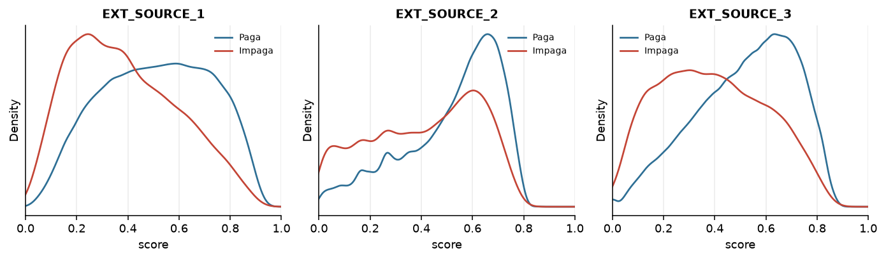
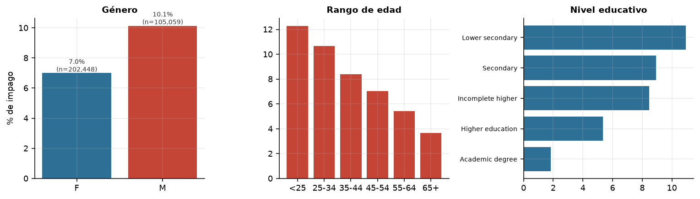

# Ayni 🤝


<!--  -->

**Scoring de riesgo crediticio de punta a punta: modelo explicable, decisión por costo y monitoreo de drift.**

> *Ayni* es el principio andino de reciprocidad: dar y devolver. El crédito funciona igual, sobre la confianza de que lo recibido será devuelto.

> 🚧 **En desarrollo.** El proyecto está en fase de setup: todavía no hay resultados. Esta
> portada se completa con cifras medidas a medida que avancen las fases; **nada de lo que
> sigue es un resultado obtenido todavía**.

---

## Resultados clave

> _Sin resultados aún._ Esta sección se llena al cerrar las fases 4–6, con números medidos.

Lo que existe hoy es el objetivo, no el logro:

| Qué | Estado |
|---|---|
| Modelo principal | LightGBM sobre features agregadas por cliente — fase 4 |
| Decisión | umbral por costo esperado en vez de 0.5 — fase 5 |
| Explicación | 5 *reason codes* por decisión vía SHAP — fase 6 |
| Servicio | `/predict` y `/explain` en Docker — fase 7 |
| CI | ruff + tests + ROC-AUC mínimo — fase 8 |

| Métrica (test, sin tocar hasta la evaluación final) | Valor |
|---|---|
| ROC-AUC · LightGBM | pendiente |
| ROC-AUC · baseline logístico | pendiente |
| PR-AUC · LightGBM | pendiente |
| Costo total vs. umbral 0.5 | pendiente |

---

## Problema y motivación

Un banco no gana por predecir bien: gana por decidir bien. **Aprobar a un mal pagador cuesta varias veces más que rechazar a un buen cliente**, así que el umbral de 0.5 —el que trae cualquier modelo por defecto— no es una decisión económica, es una decisión arbitraria.

Además, en crédito la predicción tiene que ser explicable: si el banco rechaza a alguien, debe poder decirle por qué. Un modelo opaco no es desplegable, por bueno que sea. Y un modelo que envejece sin monitoreo es un pasivo silencioso.

Ayni cubre las tres cosas: la predicción, la decisión por costo y la explicación, dentro de un pipeline que se puede reproducir y monitorear.

---

## Uso rápido

> Aún no ejecutable: el servicio se implementa en la fase 7. Lo que sigue es el uso previsto,
> no una demostración que funcione hoy.

```bash
docker compose up        # API en :8000/docs · MLflow en :5000
```

```bash
curl -X POST localhost:8000/predict -H "Content-Type: application/json" \
  -d '{"AMT_INCOME_TOTAL": 180000, "AMT_CREDIT": 450000, "AMT_ANNUITY": 24500,
       "DAYS_BIRTH": -12400, "DAYS_EMPLOYED": -1400, "CODE_GENDER": "F",
       "NAME_CONTRACT_TYPE": "Cash loans"}'
```

Respuesta esperada:

```json
{"probability": 0.09, "decision": "approve", "threshold": 0.23, "model_version": "..."}
```

```bash
curl -X POST localhost:8000/explain -H "Content-Type: application/json" -d @client.json
```

```json
{"probability": 0.41, "decision": "reject",
 "reasons": [
   {"feature": "EXT_SOURCE_2", "contribution": -0.31, "direction": "increases_risk"},
   {"feature": "credit_income_ratio", "contribution": -0.12, "direction": "increases_risk"}
 ]}
```

---

## Datos

**Home Credit Default Risk** — [Kaggle](https://www.kaggle.com/competitions/home-credit-default-risk).

| Tabla | Contenido | Grano | Filas |
|---|---|---|---:|
| `application_train.csv` | Solicitud actual: ingresos, monto, edad, empleo | 1 fila por solicitud | 307 511 |
| `bureau.csv` | Créditos en otras entidades | 1 fila por crédito previo | 1 716 428 |
| `previous_application.csv` | Solicitudes previas en Home Credit | 1 fila por solicitud previa | 1 670 214 |
| `installments_payments.csv` | Cuotas pagadas | 1 fila por cuota | 13 605 401 |
| `credit_card_balance.csv` | Saldos mensuales de tarjeta | 1 fila por mes | 3 840 312 |

- **Target:** `TARGET` (1 = impago). **Desbalance medido:** **8.07 %** de impagos
  (24 825 de 307 511), ratio 11.4:1 frente a los que pagan.
- **`EXT_SOURCE_1/2/3`** son las variables continuas más predictivas (correlación −0.155 / −0.160 /
  −0.179 con el impago), pero `EXT_SOURCE_1` viene nula en el 56 % de las filas.
- **Particularidades verificadas en el EDA:** 41 de 122 columnas tienen >50 % de nulos;
  `DAYS_EMPLOYED = 365243` es un centinela ("jubilado/desempleado", 18.0 % de las filas) y no un
  valor real; `DAYS_BIRTH` viene en días negativos.
- El análisis completo está en [`notebooks/01_eda.ipynb`](notebooks/01_eda.ipynb), con seis figuras
  en [`reports/figures/`](reports/figures/).
- `application_test.csv` no trae `TARGET`, así que el test set de evaluación se reserva a partir de `application_train`.

> Los datos no se versionan (`data/` está en `.gitignore`): **3.2 GB** de CSV, que quedan en 530 MB
> tras convertirlos a Parquet. Conteos medidos con `ayni check`.

---

## Enfoque y arquitectura


1. **Features en SQL, no en pandas.** Cada tabla se agrega a una fila por `SK_ID_CURR` con un `.sql` propio; DuckDB lee los Parquet sin cargarlos enteros en memoria. Resultado: **188 columnas, 60 de ellas agregadas** de 4 tablas relacionales, en 17 s.
2. **Validación antes de modelar.** Tres esquemas Pandera (tabla cruda, features, particiones) cortan el pipeline si aparecen tipos, rangos o nulos imposibles; `ayni validate` comprueba lo ya escrito y devuelve código de salida 1. Un CSV corrupto de prueba en `tests/fixtures/` demuestra que el corte funciona.
3. **Split estratificado 80/20 con semilla fija.** El 20 % de test no se toca hasta la evaluación final; todo lo demás se decide en validación cruzada.
4. **Dos métricas, no una.** ROC-AUC para comparar con el estándar de la competencia y PR-AUC porque con 8 % de positivos es la lectura honesta.
5. **Desbalance por pesos, no por resampling.** Se compara `scale_pos_weight` contra no ajustar, y decide la métrica, no la intuición.
6. **Umbral por costo.** Se recorre la curva de umbrales y se elige el que minimiza el costo esperado, con la matriz documentada.
7. **Explicación dentro del servicio.** SHAP global para el reporte, SHAP local convertido en *reason codes* para cada decisión individual.
8. **Trazabilidad completa.** Cada corrida queda en MLflow y el mejor modelo va al Model Registry con su umbral pegado al artefacto.

---

## Resultados

### Modelos

| Modelo | ROC-AUC (CV) | ROC-AUC (test) | PR-AUC (test) |
|---|---|---|---|
| Logistic Regression (baseline) | _pendiente_ | _pendiente_ | _pendiente_ |
| LightGBM | _pendiente_ | _pendiente_ | _pendiente_ |

### Decisión por costo

| Umbral | Tasa de aprobación | Impago entre aprobados | Costo total |
|---|---|---|---|
| 0.50 (por defecto) | _pendiente_ | _pendiente_ | _pendiente_ |
| Óptimo por costo: _—_ | _pendiente_ | _pendiente_ | _pendiente_ |

### Figuras

**EDA (fase 1)** — análisis completo en [`notebooks/01_eda.ipynb`](notebooks/01_eda.ipynb),
seis figuras en [`reports/figures/`](reports/figures/).

| | |
|---|---|
|  | Las tres `EXT_SOURCE_*` separan con claridad a quien paga de quien no: son el núcleo del modelo y, a la vez, lo más difícil de explicar a un cliente. |
|  | El impago es 1.45× mayor en hombres y 3.4× mayor en menores de 25 que en mayores de 65. De aquí sale la decisión de excluir `CODE_GENDER` del modelo. |

_Pendientes de las fases 5 y 6: costo vs. umbral y SHAP summary._

---

## Decisiones y aprendizajes

> Esta sección se amplía fase por fase; la versión detallada, con alternativas descartadas y números, está en la bitácora.

- **ROC-AUC y PR-AUC en vez de accuracy:** con 92 % de buenos pagadores, un modelo que aprueba a todos tiene 92 % de accuracy y quiebra al banco.
- **LightGBM como modelo principal, regresión logística como baseline:** los datos son tabulares, con nulos y categóricas de alta cardinalidad; el baseline existe para demostrar cuánto aporta la complejidad, no para competir.
- **Agregaciones en SQL sobre DuckDB en vez de `groupby` en pandas:** las tablas relacionadas tienen decenas de millones de filas; el SQL es reproducible, legible y no exige cargar todo en RAM.
- **El test no se toca hasta el final:** cada decisión de features, hiperparámetros y umbral se toma en validación. Un test consultado dos veces deja de ser test.
- **Umbral distinto de 0.5:** aprobar a un mal pagador cuesta 5 y rechazar a un buen cliente cuesta 1; el punto que minimiza el costo esperado no es el punto que maximiza el F1.
- **Género y edad:** `CODE_GENDER` es altamente predictivo y también discriminatorio; la decisión y su justificación quedan documentadas en la bitácora antes de entrenar.
- **Pendiente de documentar:** qué no funcionó (features descartadas, configuraciones que empeoraron el modelo).

---

## Limitaciones y trabajo futuro

- **La matriz de costos es supuesta.** 5:1 es un supuesto de negocio razonable, no un dato del banco. El pipeline la deja como parámetro para poder recalcular el umbral con costos reales.
- **El drift es simulado.** Se alteran features del test a propósito; detectar ese drift prueba que el monitoreo funciona, no que el modelo aguante producción real.
- **Riesgo de sesgo.** Edad y género correlacionan con el target y con decisiones históricas; el modelo puede heredar discriminación aunque no las use directamente.
- **Una sola foto temporal.** No hay validación out-of-time porque el dataset no trae fechas de originación reales.
- **Trabajo futuro:** reentrenamiento programado, feature store, y reglas de negocio encima del score.

---

## Cómo reproducirlo

> Aún no ejecutable: el pipeline se construye en las fases 0–4. Estos serán los comandos.

```bash
# 1. Entorno (Python 3.13)
python -m venv .venv
source .venv/bin/activate        # Windows: .venv\Scripts\activate
pip install -r requirements.txt
pip install -e . --no-deps       # habilita el comando `ayni`
pre-commit install

# 2. Datos (requiere cuenta de Kaggle y aceptar las reglas de la competencia)
ayni download                    # descarga y descomprime en data/raw (~1.3 GB)
ayni data                        # verifica que estén las 8 tablas
ayni parquet                     # CSV → Parquet en data/interim

# 3. Pipeline
make features      # SQL en DuckDB → data/processed/features.parquet
make train         # entrena y registra en MLflow
make evaluate      # métricas en test, umbral por costo y figuras SHAP

# 4. Servicios
docker compose up  # API :8000/docs · MLflow :5000

# 5. Calidad
pytest
```

En Windows no hay `make`: cada target existe también como subcomando de `ayni`
(`ayni parquet`, `ayni features`, `ayni train`, `ayni evaluate`, `ayni drift`).

---

<details>
<summary>Estructura del repositorio</summary>

```
Ayni/
├── data/
│   ├── raw/                      # CSV de Kaggle (no versionado)
│   └── processed/                # features.parquet (no versionado)
├── sql/
│   ├── bureau_agg.sql
│   ├── previous_agg.sql
│   ├── installments_agg.sql
│   └── credit_card_agg.sql
├── notebooks/
│   └── 01_eda.ipynb
├── src/ayni/
│   ├── features.py               # ejecuta los SQL en DuckDB y une todo
│   ├── schema.py                 # esquemas Pandera
│   ├── train.py                  # entrenamiento + registro en MLflow
│   ├── threshold.py              # umbral óptimo por costo
│   ├── explain.py                # SHAP global y por cliente
│   ├── drift.py                  # reporte de drift con Evidently
│   └── api.py                    # servicio FastAPI
├── tests/
│   ├── fixtures/                 # muestra mínima para CI
│   ├── test_features.py
│   ├── test_schema.py
│   ├── test_model_quality.py
│   └── test_api.py
├── reports/
│   └── figures/
├── .github/workflows/ci.yml
├── Dockerfile
├── docker-compose.yml
├── Makefile
├── requirements.txt
└── README.md
```

</details>

---

**Stack:** Python 3.13 · DuckDB · pandas · PyArrow · scikit-learn · LightGBM · MLflow · SHAP · Pandera · Evidently · FastAPI · Docker · GitHub Actions · ruff
**Autor:** Leonardo Joaquín Rodríguez · [GitHub](https://github.com/leo-dev11) · Licencia MIT
