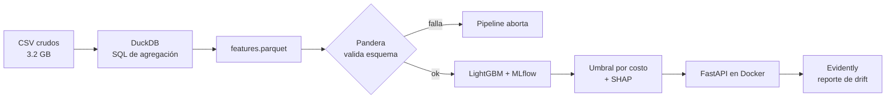

# Ayni 🤝


**Scoring de riesgo crediticio end-to-end: el umbral se elige por costo, cada rechazo viene con sus razones y el drift se monitorea.**

> *Ayni* es el principio andino de reciprocidad: dar y devolver. El crédito funciona igual, sobre la confianza de que lo recibido será devuelto.

---

## Resultados clave

**Evaluación final sobre el test congelado (61 503 solicitudes).** El test se leyó dos veces. La
segunda fue después de fijar `deterministic=True` en LightGBM para que los números se pudieran
reproducir (ROC-AUC 0.7829 → 0.7815). Ninguna decisión salió de mirar el test.

- **ROC-AUC 0.782** y **PR-AUC 0.277** en test, frente a 0.780 / 0.269 en validación cruzada. El
  modelo generaliza.
- **El umbral óptimo es 0.155, no 0.5.** Con 0.5 se aprueba al 99.3 % de los solicitantes; con el
  corte calculado, al **86.6 %**.
- **El costo total baja un 17.3 %** (23 862 → 19 744) y la mora entre aprobados pasa del
  **7.8 % al 5.2 %**.
- **Excluir `CODE_GENDER` cuesta +0.0014 AUC** (0.7802 con género, 0.7789 sin él, con los mismos
  hiperparámetros). Son menos de dos milésimas, así que el rendimiento no justifica volver a
  incluirlo.
- **`scale_pos_weight` empeora el modelo** (0.7776 vs 0.7789). El desbalance se resuelve en el
  umbral, no en el entrenamiento.


| Métrica | Validación cruzada | Test |
|---|---|---|
| ROC-AUC · LightGBM | **0.7798** ± 0.0026 | **0.7815** |
| PR-AUC · LightGBM | **0.2692** | **0.2768** |
| ROC-AUC · baseline logístico | 0.7658 ± 0.0019 | — |
| PR-AUC · baseline logístico | 0.2439 | — |
| Costo total al umbral 0.5 | 95 871 (0.390/solicitud) | 23 862 (0.388/solicitud) |
| Costo total al umbral 0.155 | **80 220 (0.326/solicitud)** | **19 744 (0.321/solicitud)** |

---

## Problema y motivación

Un banco no gana por predecir bien, gana por decidir bien. **Aprobar a alguien que no paga cuesta varias veces más que rechazar a un buen cliente**, y el umbral de 0.5 que trae cualquier modelo por defecto ignora esa diferencia. Usarlo es una decisión arbitraria, no económica.

En crédito, además, cada rechazo tiene que poder explicarse: si el banco dice que no, debe decir por qué. Un modelo opaco no se puede desplegar por bueno que sea, y uno que nadie monitorea se degrada sin que nadie lo note.

Ayni cubre esas tres partes en un solo pipeline, reproducible y con monitoreo.

---

## Uso rápido

> Necesitas el entorno instalado y el modelo exportado. Los pasos completos están en
> [Cómo reproducirlo](#cómo-reproducirlo).

```bash
ayni export-model        # deja el modelo y el umbral en models/
docker compose up        # API en :8000/docs · MLflow en :5000
```

```bash
curl -X POST localhost:8000/predict \
  -H "Content-Type: application/json" \
  -d '{"amt_income_total": 180000, "amt_credit": 450000, "amt_annuity": 24500,
       "age_years": 34, "years_employed": 4, "ext_source_1": 0.55,
       "ext_source_2": 0.61, "ext_source_3": 0.40, "contract_type": "Cash loans"}'
```

```json
{"probabilidad": 0.0614, "decision": "approve", "umbral": 0.155, "modelo_version": "1"}
```

Para un cliente de alto riesgo, `/explain` devuelve además las razones que se le darían al
rechazarlo:

```bash
curl -X POST localhost:8000/explain \
  -H "Content-Type: application/json" \
  -d '{"amt_income_total": 96000, "amt_credit": 900000, "amt_annuity": 45000,
       "age_years": 23, "children": 3, "family_members": 5,
       "ext_source_1": 0.12, "ext_source_2": 0.18, "ext_source_3": 0.09,
       "education": "Lower secondary", "occupation": "Low-skill Laborers",
       "organization": "Self-employed", "bureau_debt_ratio": 0.95,
       "prev_refusal_rate": 0.9, "inst_late_rate": 0.45}'
```

```json
{"probabilidad": 0.5972, "decision": "reject", "umbral": 0.155, "modelo_version": "1",
 "razones": [
   {"feature": "EXT_SOURCE_3",       "valor": 0.09,  "contribucion": 0.9877, "direccion": "aumenta_riesgo"},
   {"feature": "EXT_SOURCE_2",       "valor": 0.18,  "contribucion": 0.5596, "direccion": "aumenta_riesgo"},
   {"feature": "EXT_SOURCE_1",       "valor": 0.12,  "contribucion": 0.5348, "direccion": "aumenta_riesgo"},
   {"feature": "prev_refusal_rate",  "valor": 0.9,   "contribucion": 0.2147, "direccion": "aumenta_riesgo"},
   {"feature": "bureau_debt_ratio",  "valor": 0.95,  "contribucion": 0.2117, "direccion": "aumenta_riesgo"}
 ],
 "cobertura": 0.108, "advertencia": null}
```

`cobertura` es la fracción de los 185 campos del modelo que llegó en la petición. Si es muy baja,
se activa `advertencia`: el servicio no da razones sobre datos que no recibió. La API cubre como
máximo el **15.7 %** de esos 185 campos; el resto son columnas del expediente que el modelo usa y
la API no pide. Los que faltan entran como nulos, igual que en el entrenamiento.

---

## Datos

**Home Credit Default Risk** — [Kaggle](https://www.kaggle.com/competitions/home-credit-default-risk).

| Tabla | Contenido | Grano | Filas |
|---|---|---|---:|
| `application_train.csv` | Solicitud actual: ingresos, monto, edad, empleo | 1 fila por solicitud | 307 511 |
| `bureau.csv` | Créditos en otras entidades | 1 fila por crédito previo | 1 716 428 |
| `previous_application.csv` | Solicitudes previas en Home Credit | 1 fila por solicitud previa | 1 670 214 |
| `installments_payments.csv` | Cuotas pagadas | 1 fila por cuota | 13 605 401 |
| `credit_card_balance.csv` | Saldos mensuales de tarjeta | 1 fila por mes | 3 840 312 |

- **Target:** `TARGET` (1 = impago). **Desbalance:** **8.07 %** de impagos (24 825 de 307 511),
  un ratio de 11.4:1 frente a los que pagan.
- **`EXT_SOURCE_1/2/3`** son las variables continuas más predictivas (correlación −0.155 / −0.160 /
  −0.179 con el impago), aunque `EXT_SOURCE_1` viene nula en el 56 % de las filas.
- **Lo que mostró el EDA:** 41 de 122 columnas tienen >50 % de nulos; `DAYS_EMPLOYED = 365243` es
  un valor centinela ("jubilado/desempleado", 18.0 % de las filas), no un dato real; y
  `DAYS_BIRTH` viene en días negativos.
- El análisis completo está en [`notebooks/01_eda.ipynb`](notebooks/01_eda.ipynb), con seis figuras
  en [`reports/figures/`](reports/figures/).
- `application_test.csv` no trae `TARGET`, así que el test de evaluación se separa de `application_train`.

> Los datos no están en el repo (`data/` está en `.gitignore`): son **3.2 GB** de CSV, que quedan
> en 530 MB en Parquet. Los conteos salen de `ayni check`.

---

## Enfoque y arquitectura



1. **Features en SQL, no en pandas.** Cada tabla se agrega a una fila por `SK_ID_CURR` con su propio `.sql`, y DuckDB lee los Parquet sin cargarlos enteros en memoria. Salen **188 columnas, 60 de ellas agregadas** de 4 tablas relacionales, en 17 s.
2. **Validación antes de modelar.** Tres esquemas Pandera (tabla cruda, features y particiones) detienen el pipeline si aparecen tipos, rangos o nulos imposibles. `ayni validate` revisa lo que ya está escrito y sale con código 1 si algo falla. En `tests/fixtures/` hay un CSV corrupto que prueba que el corte funciona.
3. **Split estratificado 80/20 con semilla fija.** El 20 % de test queda cerrado hasta la evaluación final; todo lo demás se decide en validación cruzada.
4. **Dos métricas.** ROC-AUC para comparar con el estándar de la competencia, y PR-AUC porque con 8 % de positivos es la lectura más realista.
5. **Peso de clases, probado y descartado.** `scale_pos_weight` bajó el ROC-AUC (0.7776 vs 0.7789), así que el desbalance se resuelve en el umbral de decisión.
6. **Umbral por costo.** Se recorre la curva de umbrales y se elige el que minimiza el costo esperado según la matriz documentada.
7. **Explicaciones dentro del servicio.** SHAP global para el reporte y SHAP local convertido en *reason codes* para cada decisión.
8. **Trazabilidad.** Cada corrida queda en MLflow, y el mejor modelo va al Model Registry con su umbral pegado al artefacto.
9. **Quality gate.** `ayni evaluate` falla si el ROC-AUC del test baja de **0.75**. CI corre los 66 tests en cada push sin necesitar el dataset: todo se construye con datos sintéticos y modelos diminutos.

---

## Resultados

### Modelos

Validación cruzada de 5 folds sobre `train.parquet` (246 008 filas), con cinco corridas
comparables registradas en MLflow. El campeón es `lgbm-ajustado` (v1 del Registry).

| Corrida | ROC-AUC (CV) | PR-AUC (CV) | Notas |
|---|---|---|---|
| `lgbm-ajustado` | **0.7798** ± 0.0026 | **0.2692** | campeón registrado |
| `lgbm-base` | 0.7789 ± 0.0026 | 0.2676 | hiperparámetros por defecto |
| `lgbm-pos-weight` | 0.7776 ± 0.0025 | 0.2665 | `scale_pos_weight` = 11.4 |
| `baseline-logreg` | 0.7658 ± 0.0019 | 0.2439 | imputación + escalado + one-hot |
| `lgbm-con-genero` | 0.7802 ± 0.0026 | 0.2690 | **solo para medir**, excluida del registro |

| ROC-AUC (test) | PR-AUC (test) |
|---|---|
| **0.7815** | **0.2768** |

### Decisión por costo

La matriz: aprobar a quien no paga cuesta **5** (se pierde el principal) y rechazar a quien sí
pagaría cuesta **1** (se pierde el margen). El umbral se eligió con las predicciones
**out-of-fold**, nunca con el test.

| Umbral | Tasa de aprobación | Impago entre aprobados | Costo total | Costo por solicitud |
|---|---:|---:|---:|---:|
| 0.50 (por defecto) | 99.3 % | 7.8 % | 23 862 | 0.388 |
| **0.155 (óptimo)** | **86.6 %** | **5.2 %** | **19 744** | **0.321** |

Resultados sobre el test congelado (61 503 solicitudes; el fingerprint se verifica antes de leerlo).

**El umbral depende de los costos, no del modelo.** Con un modelo calibrado, el corte en el que da
igual aprobar que rechazar vale `1/(ratio+1)`. El barrido empírico lo reproduce casi exacto, lo que
confirma que las probabilidades están bien calibradas:

| Ratio FN:FP | Umbral óptimo medido | Teoría `1/(ratio+1)` | Tasa de aprobación |
|---|---:|---:|---:|
| 1:1 | 0.530 | 0.500 | 99.6 % |
| 2:1 | 0.365 | 0.333 | 97.9 % |
| 5:1 | 0.155 | 0.167 | 86.6 % |
| 10:1 | 0.085 | 0.091 | 71.2 % |
| 20:1 | 0.045 | 0.048 | 48.1 % |
| 50:1 | 0.020 | 0.020 | 16.7 % |


`ORGANIZATION_TYPE` aparece primero, por delante de las tres `EXT_SOURCE_*`. Es una categórica de
58 niveles, y la importancia por defecto de LightGBM (cuántas veces se usa una feature para hacer
un split) favorece a ese tipo de variable, así que el orden exacto hay que tomarlo con pinzas. Lo
que sí se sostiene es que **las `EXT_SOURCE_*` son el bloque continuo más fuerte** y que tres
ratios del feature engineering (`prev_credit_application_ratio`, `bureau_debt_ratio`,
`annuity_income_ratio`) entran al top 20.

### Explicabilidad

SHAP sobre una muestra de 5 000 solicitudes de train. **El ranking no coincide con la importancia
nativa de LightGBM, y eso es lo interesante:** `ORGANIZATION_TYPE` es la #1 por número de splits
(al ser una categórica de 58 niveles, infla esa métrica), la #3 por gain y baja al **#6** cuando se
mide su impacto real en la predicción.

| # | Feature | \|SHAP\| medio |
|---|---|---:|
| 1 | `EXT_SOURCE_2` | 0.3049 |
| 2 | `EXT_SOURCE_3` | 0.2771 |
| 3 | `EXT_SOURCE_1` | 0.1576 |
| 4 | `prev_cnt_payment_max` | 0.1151 |
| 5 | `goods_credit_ratio` | 0.1039 |
| 6 | `ORGANIZATION_TYPE` | 0.0919 |


Las tres `EXT_SOURCE_*` dominan y su efecto es monótono: un score alto (rojo) baja el riesgo. Los
ratios del feature engineering aparecen en el top 10, así que ese trabajo sí aportó.


**Dos casos reales**, elegidos por tener la probabilidad mediana de su grupo (no los extremos):

- **Aprobado (P = 0.040):** lo sostiene sobre todo un `EXT_SOURCE_3` alto (0.87, −0.515), y
  ayudan la edad (51 años), no tener deuda viva en el buró y que sus créditos previos fueran de 12
  cuotas como máximo. La figura también muestra lo que juega en contra (`EXT_SOURCE_2`, +0.41),
  pero al cliente solo se le comunican las razones que bajan el riesgo.
- **Rechazado (P = 0.234):** `EXT_SOURCE_2 = 0.25` aporta +0.502, trabajar en construcción
  (`ORGANIZATION_TYPE`) suma +0.353 y haber pagado tarde el 35 % de sus cuotas previas
  (`inst_late_rate`) añade +0.191. Son motivos que un analista de crédito puede defender.

### Reason codes

`ayni explain` genera el mismo formato que devuelve `/explain`: las cinco features con mayor
\|SHAP\|, con su valor, su contribución en log-odds y hacia dónde mueven el riesgo. **Las razones
dependen de la decisión:** un rechazo solo lleva motivos que suben el riesgo, y una aprobación solo
los que lo bajan. Darle a alguien rechazado un argumento a su favor confunde y, en banca, no se
sostiene.

```json
{"sk_id_curr": 396395, "probabilidad": 0.2344, "umbral": 0.155, "decision": "reject",
 "razones": [
   {"feature": "EXT_SOURCE_2",         "valor": 0.2479,         "contribucion": 0.5023, "direccion": "aumenta_riesgo"},
   {"feature": "ORGANIZATION_TYPE",    "valor": "Construction", "contribucion": 0.3533, "direccion": "aumenta_riesgo"},
   {"feature": "inst_late_rate",       "valor": 0.35,           "contribucion": 0.1913, "direccion": "aumenta_riesgo"},
   {"feature": "OCCUPATION_TYPE",      "valor": "Laborers",     "contribucion": 0.1898, "direccion": "aumenta_riesgo"},
   {"feature": "prev_cnt_payment_max", "valor": 42.0,           "contribucion": 0.1379, "direccion": "aumenta_riesgo"}
 ]}
```

Los valores están en **log-odds**, la escala en la que trabaja el modelo. Pasarlos a puntos de
score o a probabilidad es una cuestión de presentación.

### Sesgo, medido

Excluir `CODE_GENDER` del modelo no garantiza un resultado justo, porque el sesgo puede colarse por
variables correlacionadas. La auditoría usa las **predicciones OOF** (las mismas con las que se
eligió el umbral) y mira cada grupo por separado con tres preguntas:

- **¿A quién se aprueba?** Tasa de aprobación total y entre quienes sí pagaron.
- **¿Qué riesgo se asume?** Mora entre los aprobados.
- **¿El modelo le asigna a cada grupo el riesgo que tiene?** Mora predicha (promedio de la
  probabilidad) contra mora observada. Es la **calibración por grupo**, y es la única de las tres
  que dice si una brecha se explica por riesgo.

| Género | n | Aprobación | Aprob. entre los que pagan | Mora observada | Mora predicha | Mora entre aprobados | Regla del 80 % |
|---|---:|---:|---:|---:|---:|---:|---:|
| F | 161 887 | **88.7 %** | 90.9 % | 7.0 % | **7.3 %** | 4.7 % | 1.00 |
| M | 84 119 | 82.6 % | 86.1 % | 10.1 % | **9.3 %** | 6.4 % | 0.93 |

| Tramo de edad | n | Aprobación | Aprob. entre los que pagan | Mora observada | Mora predicha | Mora entre aprobados | Regla del 80 % |
|---|---:|---:|---:|---:|---:|---:|---:|
| <25 | 9 841 | 71.5 % | 75.6 % | 12.4 % | 12.6 % | 7.5 % | **0.73** |
| 25-34 | 58 061 | 78.8 % | 82.6 % | 10.7 % | 10.5 % | 6.4 % | **0.799** |
| 35-44 | 67 372 | 86.4 % | 89.2 % | 8.4 % | 8.1 % | 5.5 % | 0.88 |
| 45-54 | 56 151 | 89.8 % | 91.9 % | 7.0 % | 7.0 % | 4.8 % | 0.91 |
| 55-64 | 48 357 | 94.3 % | 95.5 % | 5.4 % | 5.4 % | 4.2 % | 0.96 |
| 65+ | 6 226 | 98.6 % | 98.9 % | 3.7 % | 3.6 % | 3.4 % | 1.00 |


Edad y género no son el mismo caso:

- **Edad: no cumple la regla del 80 %** en menores de 25 (0.73) y queda justo por debajo en 25-34
  (0.799). Pero la calibración es buena en todos los tramos (predicha y observada difieren en
  menos de medio punto): el modelo le asigna a cada edad el riesgo que de verdad tiene, así que la
  brecha es de **riesgo medido** y no un error del modelo. Que a los buenos pagadores jóvenes se
  les apruebe menos (75.6 % vs 98.9 %) es lo esperable: si las tasas de impago son distintas, un
  modelo calibrado **no puede** igualar también la aprobación de los buenos pagadores. Las dos
  propiedades son incompatibles salvo con un modelo perfecto. Cuál priorizar es una decisión de
  política, y en varios marcos legales la edad es una categoría protegida, con matices. Lo dejo
  documentado como un tema abierto.
- **Género: cumple la regla del 80 %** (0.93), pero la calibración muestra algo que la tasa de
  aprobación no. Sin `CODE_GENDER`, el modelo **sobrestima el riesgo de las mujeres** (7.3 %
  predicho vs 7.0 % real) y **subestima el de los hombres** (9.3 % vs 10.1 %). Como no ve la
  variable, promedia a los dos grupos, y ese promedio lo pagan ellas. Quitar una variable no la
  vuelve neutral. Corregirlo exigiría usar el género (por ejemplo, para calibrar por grupo), y eso
  trae su propio problema legal. También queda abierto.

### Monitoreo de drift

Para simular una cartera de producción, se toma train y se alteran cuatro cosas a propósito:
ingresos +30 %, `EXT_SOURCE_2` −0.15, edad +4 años y 30 % de los `Cash loans` convertidos en
`Revolving loans`, con los ratios recalculados. Después, Evidently la compara con la referencia.


**Se detectan las 7 alteraciones, con 0 falsos positivos.** La separación es clara: la feature
alterada que menos se movió queda en **0.22**, la intacta más ruidosa en **0.07**, y el umbral está
en **0.1**. Las siete son las cuatro plantadas más los tres ratios que dependen del ingreso.

El reporte HTML completo se genera con `ayni drift` (`reports/drift_reporte.html`, ~5 MB, fuera
del repo). El resumen con las distancias por feature está en
[`reports/drift_resumen.json`](reports/drift_resumen.json).

### Figuras

**Análisis exploratorio**: el notebook completo está en
[`notebooks/01_eda.ipynb`](notebooks/01_eda.ipynb), con seis figuras en
[`reports/figures/`](reports/figures/).

| | |
|---|---|
|  | Las tres `EXT_SOURCE_*` separan claramente a quien paga de quien no. Son el núcleo del modelo y también lo más difícil de explicarle a un cliente. |
|  | El impago es 1.45× mayor en hombres y 3.4× mayor en menores de 25 que en mayores de 65. De aquí salió la decisión de excluir `CODE_GENDER` del modelo. |


---

## Decisiones y aprendizajes

> Cada decisión viene con la alternativa descartada y el número que la justifica.

- **El umbral es un techo de riesgo.** Se aprueba si `P(impago) ≤ umbral`. La primera versión lo
  tenía al revés (`p >= umbral`) y el resultado fue llamativo: el óptimo caía en el borde del grid
  (0.01) y aprobaba al 97 % de los solicitantes *porque aprobaba a los más riesgosos*. No lo
  detectó un test, lo detectó la aritmética: para 5:1 el umbral teórico es 1/6, no 0.01.
- **0.5 es solo una convención.** Con 8 % de mora, aprobar con 0.5 rechaza al 0.7 % de la cartera:
  es una política que parece una decisión técnica. El corte calculado sí separa a los clientes.
- **ROC-AUC y PR-AUC en lugar de accuracy:** con 92 % de buenos pagadores, un modelo que aprueba a
  todos tiene 92 % de accuracy y quiebra al banco.
- **LightGBM como modelo principal y regresión logística como baseline:** los datos son tabulares, con nulos y categóricas de alta cardinalidad. El baseline está para medir cuánto aporta la complejidad, no para competir.
- **Agregaciones en SQL con DuckDB en lugar de `groupby` en pandas:** las tablas relacionadas tienen decenas de millones de filas, y en SQL eso queda legible y reproducible sin cargar todo en RAM.
- **El test no se toca hasta el final:** las decisiones de features, hiperparámetros y umbral se toman en validación. Si consultas el test para decidir, deja de ser test. Lo leí una segunda vez solo para volver a medir después de fijar `deterministic=True` (por reproducibilidad, no para ajustar nada): el ROC-AUC bajó de 0.7829 a 0.7815, y publico el segundo.
- **Umbral por costo:** aprobar a un mal pagador cuesta 5 y rechazar a un buen cliente cuesta 1. El punto que minimiza el costo esperado no es el que maximiza el F1.
- **Descarté `scale_pos_weight`:** con pesos, el ROC-AUC baja (0.7776 vs 0.7789) y el early
  stopping se dispara en la primera iteración, porque la logloss de validación deja de ser
  comparable. El desbalance se resuelve eligiendo el umbral por costo. → *Corregido en el
  camino:* ahora el early stopping mide **AUC** en lugar de logloss.
- **`CODE_GENDER` fuera, con su costo medido:** **+0.0014 AUC** frente a la corrida con los
  **mismos hiperparámetros** (0.7802 vs 0.7789). Compararlo con la mejor corrida ajustada habría
  mezclado el efecto del género con el del tuning. La variante con género se entrenó solo para
  tener ese número. El campeón se elige únicamente entre corridas sin género, y esa regla vive en
  el código (`elegir_campeon`), no en un comentario.
- **El campeón sale de la validación cruzada, nunca del test:** `elegir_campeon` ordena por
  `roc_auc_cv`, y el test sigue cerrado hasta la evaluación final.
- **`learning_rate` 0.03 y `num_leaves` 63** frente a 0.05/31: +0.0009 AUC con un 50 % más de
  tiempo (56 s vs 38 s). El tuning es mínimo, sin búsqueda exhaustiva: con una desviación de
  ±0.0026 entre folds, afinar más sería ajustar ruido.

---

## Limitaciones y trabajo futuro

- **La matriz de costos es un supuesto.** 5:1 es razonable como supuesto de negocio, pero no es un dato del banco. Por eso queda como parámetro: con 20:1 el umbral baja a 0.045 y se aprueba al 48.1 %. **La política de riesgo se cambia sin reentrenar**, moviendo dos números.
- **El drift es simulado.** Las features de `train` se alteran a propósito. Detectar ese drift prueba que el monitoreo funciona, no que el modelo aguante producción real.
- **El contrato HTTP es parcial.** La API pide 23 campos de negocio y el modelo usa 185. Lo que no llega se trata como nulo, así que una petición incompleta no equivale al expediente completo. El campo `cobertura` lo muestra en cada respuesta.
- **El sesgo está medido, pero no resuelto.** Por edad, la política no cumple la regla del 80 % (0.73 en menores de 25) aunque el modelo está calibrado por tramo. Por género la cumple (0.93), pero sin la variable el modelo sobrestima el riesgo de las mujeres. Que la decisión siga al riesgo no responde la pregunta legal.
- **Una sola foto en el tiempo.** No hay validación out-of-time porque el dataset no trae fechas reales de originación.
- **Trabajo futuro:** reentrenamiento programado, un feature store y reglas de negocio sobre el score.

---

## Cómo reproducirlo

```bash
# 1. Entorno (Python 3.13)
python -m venv .venv
source .venv/bin/activate        # Windows: .venv\Scripts\activate
pip install -r requirements.txt
pip install -e . --no-deps       # habilita el comando `ayni`
pre-commit install

# 2. Datos (requiere cuenta de Kaggle y aceptar las reglas de la competencia)
ayni download                    # descarga y descomprime en data/raw (~690 MB)
ayni data                        # verifica que estén las 8 tablas
ayni parquet                     # CSV → Parquet en data/interim
ayni validate                    # esquemas Pandera sobre lo que haya en disco

# 3. Pipeline
make features                       # SQL en DuckDB → features.parquet + split
make train                          # 5 corridas con CV + registro en MLflow
make evaluate                       # umbral por costo sobre las predicciones OOF
ayni evaluate --confirmar-test      # evaluación final: lee el test congelado
make explain                        # SHAP, reason codes y figura de importancia (usa el umbral)
make fairness                       # aprobación, mora y calibración por grupo (usa el umbral)
make drift                          # simula producción y mide drift (usa el top SHAP)
make export                         # artefacto de modelo para la API

# 4. Servicios
docker compose up                   # API :8000/docs · MLflow :5000

# 5. Calidad
pytest
```

En Windows no hay `make`, pero cada target tiene su subcomando en `ayni`
(`ayni features` + `ayni split`, `ayni train`, `ayni evaluate`, `ayni explain`,
`ayni fairness`, `ayni drift`, `ayni export-model`). El orden importa: `explain` y `fairness` leen
el umbral que escribe `evaluate`.

---

<details>
<summary>Estructura del repositorio</summary>

```
Ayni/
├── data/
│   ├── raw/                      # CSV de Kaggle (no versionado)
│   ├── interim/                  # Parquet por tabla (no versionado)
│   └── processed/                # features, split y OOF (no versionado)
├── sql/                          # una consulta de agregación por tabla
│   ├── bureau_agg.sql
│   ├── previous_agg.sql
│   ├── installments_agg.sql
│   └── credit_card_agg.sql
├── notebooks/01_eda.ipynb
├── models/                       # booster + manifest (no versionado)
├── src/ayni/
│   ├── config.py                 # rutas y constantes
│   ├── ingest.py                 # CSV → Parquet con DuckDB
│   ├── features.py               # SQL de agregación + ratios
│   ├── split.py                  # split estratificado con fingerprint
│   ├── schema.py                 # esquemas Pandera
│   ├── train.py                  # CV + MLflow + Model Registry
│   ├── threshold.py              # decisión por costo
│   ├── evaluate.py               # umbral OOF y evaluación en test
│   ├── explain.py                # SHAP global, local y reason codes
│   ├── drift.py                  # simulación de producción + Evidently
│   ├── fairness.py               # auditoría de sesgo de la política
│   ├── export.py                 # artefacto para servir
│   ├── api.py                    # FastAPI: /health, /predict, /explain
│   └── cli.py                    # python -m ayni <comando>
├── tests/
│   ├── fixtures/                 # CSV válido y corrupto de 6 filas
│   ├── test_api.py
│   ├── test_drift.py
│   ├── test_explain.py
│   ├── test_features.py
│   ├── test_quality.py
│   ├── test_schema.py
│   ├── test_smoke.py
│   ├── test_threshold.py
│   └── test_train.py
├── reports/
│   ├── figures/                  # 12 figuras
│   ├── umbral.json
│   ├── evaluacion_test.json
│   ├── drift_resumen.json
│   ├── sesgo_decision.json
│   └── razones_ejemplo.json
├── .github/workflows/ci.yml
├── Dockerfile
├── docker-compose.yml
├── LICENSE
├── requirements-api.txt          # dependencias solo del servicio
├── requirements.txt              # entrenamiento y análisis
└── README.md
```

</details>

---

**Stack:** Python 3.13 · DuckDB · pandas · PyArrow · scikit-learn · LightGBM · MLflow · SHAP · Pandera · Evidently · FastAPI · Docker · GitHub Actions · ruff
**Autor:** Leonardo Joaquín Rodríguez · [GitHub](https://github.com/leo-dev11) · [Licencia MIT](LICENSE)
